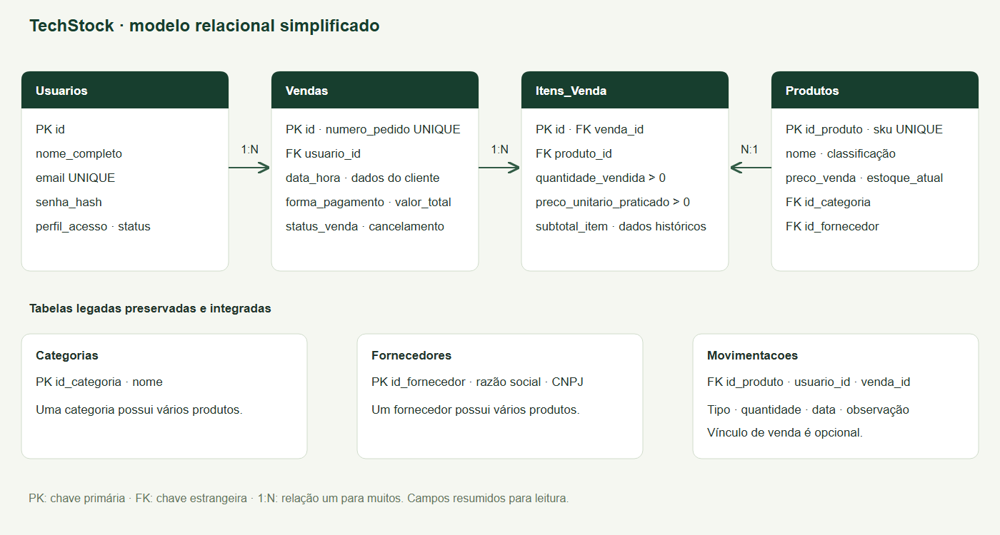
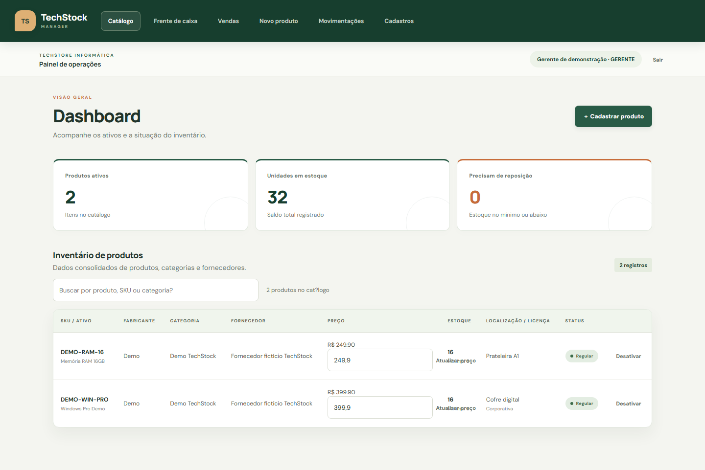
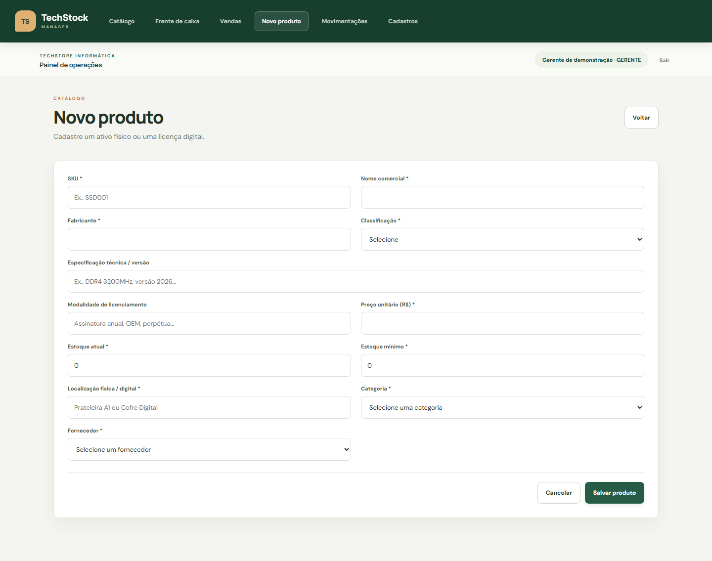
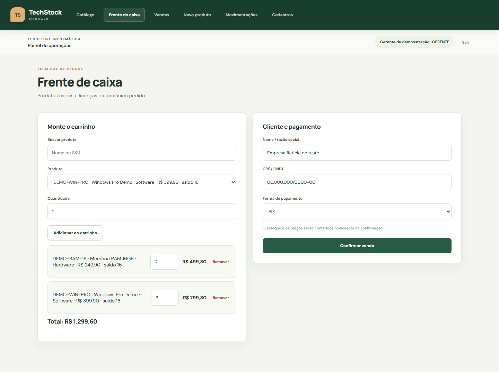
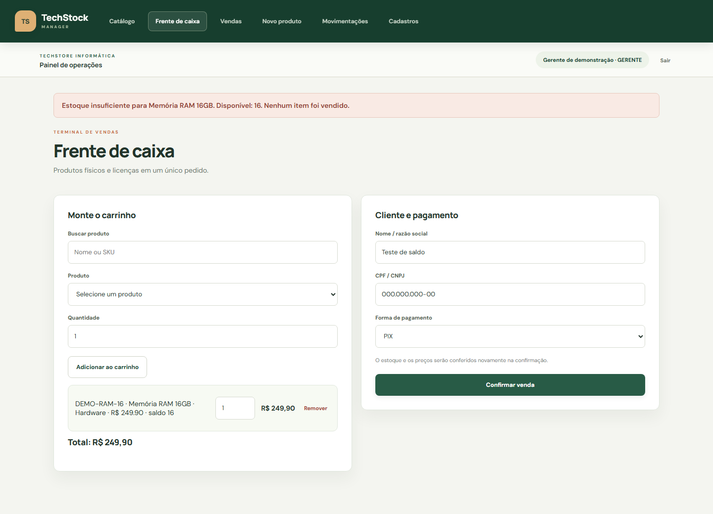
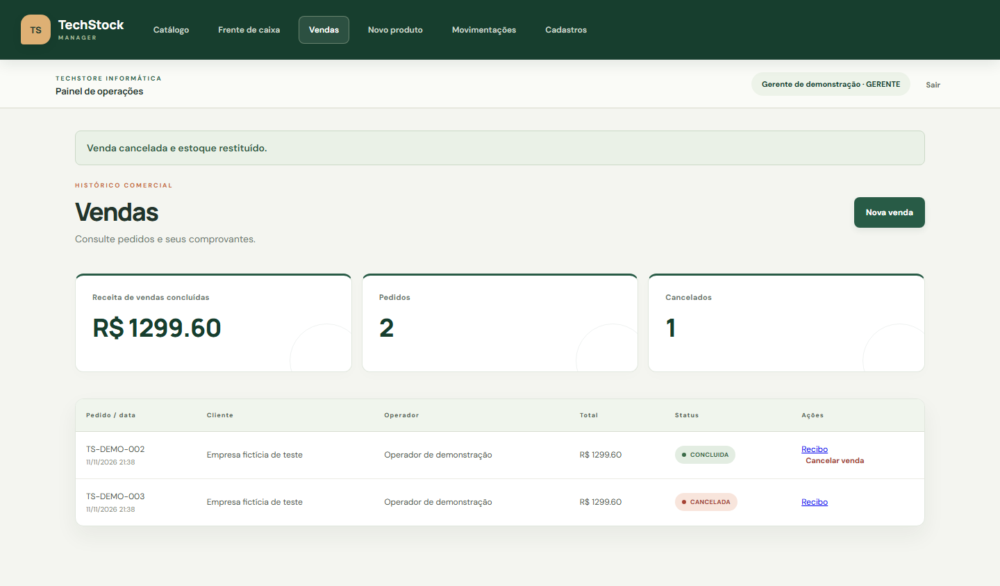
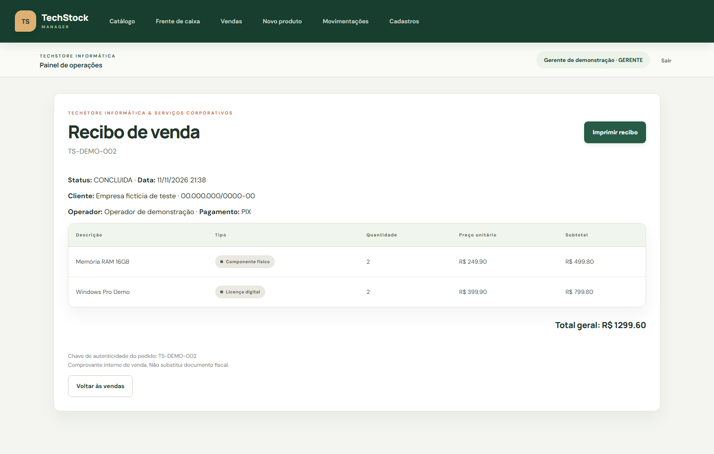
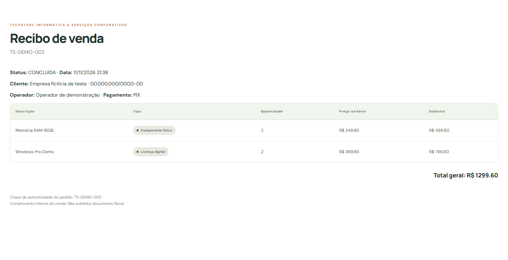
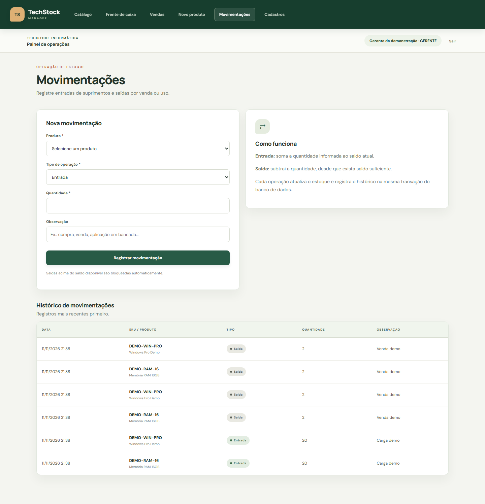

# TechStock Manager

Relatório de implementação e validação · Equipe Over

**Integrantes:** Arthur, Dimitri Santos, Enzo Frugeri, Maria Julia, Matheus Ribeiro, Vitor Ribeiro

**Data:** 11 de novembro de 2026


## 1. Apresentação e objetivos

Este relatório apresenta a evolução do TechStock Manager, desenvolvido para a demanda #2026-INV05 da TechStore Informática & Serviços Corporativos. O projeto amplia o inventário da etapa anterior com autenticação, controle de acesso por perfil, frente de caixa, processamento transacional de vendas e emissão de recibos.

O cenário proposto envolve a venda conjunta de componentes físicos e licenças digitais. A solução reúne esses itens em um único pedido, calcula os valores e mantém o vínculo entre a transação comercial, a baixa de estoque e o operador responsável.

- Evitar vendas parciais: pedido, itens, estoque e auditoria devem ser confirmados ou revertidos em conjunto.
- Separar as permissões de Operador e Gerente, protegendo alterações de catálogo e cancelamentos.
- Preservar os dados históricos da venda e oferecer um comprovante organizado para consulta e impressão.

| Tecnologia | Aplicação no projeto |
| --- | --- |
| Python e Flask | Rotas, sessões, validações e regras de negócio. |
| Jinja, HTML e CSS | Telas, mensagens e versão de impressão. |
| JavaScript | Busca, carrinho e cálculo dinâmico dos subtotais. |
| SQLite | Banco local utilizado e validado nesta entrega. |
| SQL Server / pyodbc | Backend opcional e scripts de estrutura e migração. |
| unittest | Testes isolados e integração com banco temporário. |

A execução local utiliza SQLite para dispensar a instalação de SQL Express e driver ODBC. Os arquivos para SQL Server foram mantidos, mas esse backend não foi validado contra um servidor real neste ambiente. As capturas deste relatório usam dados fictícios em um banco isolado, sem alterar os registros do usuário.


## 2. Arquitetura e modelagem relacional

A aplicação segue uma organização simples: o navegador apresenta as telas; as rotas Flask aplicam as permissões e regras; db.py seleciona a conexão; e o banco mantém o catálogo, as vendas e o histórico. A camada SQLite adapta os recursos de SQL Server usados nas consultas, incluindo o retorno do identificador da venda e a abertura da transação.



Figura 1 — Modelo relacional simplificado, elaborado a partir dos esquemas e das consultas do projeto.

| Entidade adicionada | Informações principais |
| --- | --- |
| Usuarios | Nome, e-mail único, hash da senha, perfil e status. |
| Vendas | Pedido único, cliente, pagamento, total, status e operador. |
| Itens_Venda | Venda, produto, quantidade, preço praticado e subtotal. |

As tabelas Categorias, Fornecedores, Produtos e Movimentacoes foram preservadas. As movimentações receberam vínculos opcionais de usuário e venda, permitindo identificar a origem das saídas de checkout e das entradas de estorno. Chaves estrangeiras e restrições CHECK protegem os vínculos e os valores positivos.

Nome, classificação e preço do produto são copiados para o item no momento da venda. Assim, alterações posteriores no catálogo não reescrevem o conteúdo do recibo histórico. Os scripts de criação, migração e demonstração acompanham o código-fonte.


## 3. Autenticação e controle de acesso

O acesso é realizado por e-mail e senha, com verificação de hash pelo Werkzeug. A sessão é persistente por até oito horas e os formulários POST exigem token CSRF. O perfil e o status do usuário são consultados no servidor a cada requisição, de modo que a proteção não depende apenas dos botões exibidos na interface.


Figura 2 — Tela de autenticação com identificação visual do TechStock e opção de mostrar ou ocultar a senha.

| Perfil | Permissões implementadas |
| --- | --- |
| Operador | Consultar catálogo, montar carrinho, registrar vendas e consultar/imprimir seus recibos. |
| Gerente | Operações do operador, cadastros, alteração de preços, movimentações manuais, todos os pedidos, indicadores financeiros e cancelamento. |

Foram disponibilizadas as contas operador@techstore.com e gerente@techstore.com para a demonstração. Usuários inativos são impedidos de operar e o logout encerra a sessão. As senhas iniciais e as instruções de acesso estão no README; devem ser alteradas antes de uma disponibilização fora do contexto de demonstração.


## 4. Catálogo e acompanhamento do estoque

O catálogo consolida produtos, categorias e fornecedores, exibindo SKU, fabricante, classificação, preço, saldo, estoque mínimo e localização ou modalidade de licenciamento. Os indicadores resumem a quantidade de produtos ativos, as unidades disponíveis e os itens que precisam de reposição.



Figura 3 — Inventário no perfil Gerente, com indicadores de estoque e controles de preço.

A busca filtra os registros apresentados por nome, SKU ou outros textos visíveis. Itens com saldo no mínimo ou abaixo dele recebem destaque. O gerente pode ajustar preços; essa mudança vale para compras futuras, preservando os valores praticados nos pedidos já registrados.

A navegação utiliza a mesma identidade visual em todas as telas: tons de verde, superfícies claras, cartões, mensagens de retorno e indicação da página ativa. Os componentes possuem adaptações para telas menores; a avaliação visual final em celular permanece uma conferência manual recomendada.


## 5. Cadastros e validação de produtos

O formulário de produto reúne identificação, classificação, especificação, preço, estoque inicial e mínimo, localização, categoria e fornecedor. A modalidade de licenciamento é exigida para software. O servidor verifica os campos numéricos e aplica os limites dos textos antes da gravação.



Figura 4 — Cadastro de produto com seleção de categoria e fornecedor.

A área Cadastros permite criar categorias e consultar categorias e fornecedores, com tratamento de vínculos nas exclusões. Referências usadas por produtos são protegidas por integridade referencial. Não há uma tela pública de criação de usuários; as contas de demonstração são preparadas por script.

Na entrega, schema_sqlite.sql oferece o esquema local completo. Para SQL Server, schema_v1.sql prepara a estrutura legada e migration_v2.sql acrescenta o módulo comercial. As cargas de demonstração são idempotentes: repetir a preparação não duplica os pedidos fictícios identificados pelo sistema.


## 6. Frente de caixa e carrinho multi-itens

A frente de caixa permite buscar e selecionar produtos, informar quantidades, adicionar diferentes itens, alterar quantidades e remover linhas antes da confirmação. O cliente é identificado por nome ou razão social e CPF/CNPJ. As opções de pagamento são PIX, cartão de crédito e boleto faturado.



Figura 5 — Carrinho com duas memórias RAM e duas licenças, totalizando R$ 1.299,60.

No exemplo, as memórias totalizam R$ 499,80 e as licenças R$ 799,80. O navegador calcula a apresentação em centavos inteiros. Na confirmação, o servidor desconsidera qualquer preço enviado pelo cliente e recalcula os valores com Decimal a partir do catálogo do banco.

O carrinho é mantido temporariamente no sessionStorage da aba para facilitar correções após erros. Quando o recibo concluído é aberto, esse carrinho é limpo. Essa persistência temporária não substitui a conferência de preços e estoque no momento da venda.


## 7. Checkout transacional e tratamento de falhas

A confirmação abre uma transação explícita. No SQLite é utilizado BEGIN IMMEDIATE, que reserva a escrita antes da leitura dos saldos; no SQL Server, o código utiliza BEGIN TRANSACTION e bloqueios de atualização. Os produtos são processados na ordem dos identificadores para manter uma ordem consistente de acesso.

- Conferir existência, situação ativa, preço e saldo de cada produto.
- Criar o cabeçalho em Vendas e inserir as linhas em Itens_Venda.
- Debitar o estoque e registrar as saídas em Movimentacoes com usuário e venda.
- Confirmar o conjunto com COMMIT; em caso de erro, executar rollback da conexão.



Figura 6 — Mensagem de estoque insuficiente após tentativa de compra acima do saldo disponível.

A interface informa a impossibilidade da operação sem registrar uma venda parcial. Os testes comparam o conteúdo de Produtos, Vendas, Itens_Venda e Movimentacoes antes e depois da falha. Também foi induzido um erro tardio no banco, após o início da gravação, para verificar a reversão do cabeçalho, dos itens, da baixa e da auditoria.


## 8. Histórico, indicadores e cancelamento

O histórico apresenta número e data do pedido, cliente, operador, valor e situação. O operador visualiza seus próprios pedidos; o gerente acessa o conjunto das vendas e os indicadores de receita concluída, quantidade de pedidos e cancelamentos. Cada registro disponibiliza o acesso ao recibo.



Figura 7 — Histórico após cancelamento de uma venda no banco isolado de demonstração.

O cancelamento é restrito ao gerente e ocorre em uma transação. O pedido permanece armazenado com status CANCELADA; todas as quantidades são devolvidas ao estoque; as entradas de estorno recebem o usuário responsável e o vínculo com a venda. O registro também informa quem cancelou e quando.

O backend impede cancelamento repetido. Nos testes, duas solicitações de cancelamento do mesmo pedido produziram uma única restituição de estoque. Os indicadores financeiros consideram apenas vendas concluídas no cálculo da receita exibida.


## 9. Recibo e impressão

Após uma venda bem-sucedida, o sistema redireciona para o recibo. O documento identifica a TechStore, o cliente, o operador, o pedido, a data, a forma de pagamento e os itens, com quantidades, preços e total. Badges distinguem componentes físicos de licenças digitais.



Figura 8 — Recibo de uma venda concluída, com acesso ao botão Imprimir recibo.



Figura 9 — O mesmo recibo com o CSS de impressão aplicado, sem menu nem botões.

O botão abre o diálogo de impressão do navegador, que permite imprimir ou salvar em PDF. A prévia em uma página também foi demonstrada pelo usuário. O arquivo Recibo_Demonstracao.pdf acompanha este relatório. A chave apresentada corresponde ao identificador único do pedido para conferência interna; não é uma assinatura criptográfica e o recibo não substitui documento fiscal.


## 10. Movimentações e rastreabilidade

A tela de movimentações é restrita ao gerente e permite registrar entradas e saídas manuais. Uma entrada soma ao saldo; uma saída subtrai apenas quando existe quantidade suficiente. O ajuste e seu histórico são gravados na mesma transação, com identificação do usuário responsável.



Figura 10 — Formulário e histórico de movimentações, incluindo a carga inicial e as saídas das vendas fictícias.

O histórico apresenta data, produto, tipo, quantidade e observação. Os vínculos de usuário e venda são mantidos no banco, inclusive para os movimentos automáticos de checkout e estorno.

Foi corrigida uma incompatibilidade na apresentação de datas: o SQLite retorna texto e o SQL Server retorna datetime. Um filtro compartilhado aceita os dois formatos e exibe dia/mês/ano e horário. Essa correção passou a ser coberta por testes de abertura das telas e de registro de entradas e saídas.


## 11. Validação e evidências dos testes

A execução registrada para esta entrega aprovou 17 testes: seis com conexão simulada e onze com SQLite real em arquivos temporários. A base do usuário não é alterada por esses testes. O log completo está em testes-execucao.txt.

| Grupo de verificação | Evidência obtida |
| --- | --- |
| Acesso e segurança | Login com hash real, navegação, acesso anônimo, CSRF e restrições do operador. |
| Telas e datas | Abertura das telas do gerente e recibos; formatação de texto, datetime e ausência de data. |
| Venda multi-itens | Pedido e duas linhas de itens, baixa de saldo, auditoria e recibo acessível. |
| Estoque insuficiente | Operação bloqueada, sem mudanças nas quatro tabelas envolvidas. |
| Falha tardia no banco | Trigger de teste provoca erro de gravação; todo o conjunto é revertido. |
| Concorrência | Duas conexões tentam comprar a última unidade; apenas uma conclui. |
| Cancelamento | Restauração integral do saldo, entradas de estorno e prevenção de duplicidade. |
| Integridade e carga | FKs, quantidade positiva e execução repetida da carga sem duplicação. |
| Movimentação manual | Entrada, saída, identificação do gerente e bloqueio de saída sem saldo. |

```text
.\.venv\Scripts\python.exe -m unittest discover -s tests -v

Ran 17 tests
OK
```

A execução contém mensagens de erro esperadas dos cenários de falha simulada e trigger proposital; esses registros não indicam reprovação. O resultado final do unittest foi OK. As capturas do sistema foram produzidas no Chrome em ambiente separado e o recibo de demonstração foi exportado em PDF.

Limites da validação: SQL Server não foi testado em um servidor real nesta máquina; a revisão visual em celular e em impressora física não foi automatizada. A prévia de impressão e o fluxo geral foram conferidos pelo usuário.


## 12. Atendimento aos requisitos e entrega

| Requisito | Implementação e evidência |
| --- | --- |
| REQ-01 · 2,0 pontos | Entidades, PK/FK e CHECKs; esquema e migração, Figura 1 e testes de integridade. |
| REQ-02 · 2,0 pontos | Hash, sessão e RBAC; Figura 2 e testes de segurança e permissões. |
| REQ-03 · 2,0 pontos | Carrinho multi-itens e totais dinâmicos; Figura 5 e teste de venda. |
| REQ-04 · 2,5 pontos | Transação, saldo, auditoria e rollback; Figura 6 e testes de falha tardia e concorrência no SQLite. |
| REQ-05 · 1,5 ponto | Recibo, impressão, mensagens e README; Figuras 8 e 9, PDF de exemplo e documentação. |

A matriz relaciona a implementação aos critérios fornecidos na atividade; não representa atribuição de nota. A execução validada utiliza SQLite. Caso haja orientação adicional exigindo especificamente SQL Server, deve-se selecionar esse backend e realizar a validação correspondente antes da entrega.

Para reproduzir a demonstração, instalar as dependências, executar o preparador e iniciar a aplicação:

```text
python -m venv .venv
.\.venv\Scripts\python.exe -m pip install -r requirements.txt
.\.venv\Scripts\python.exe preparar_banco.py --demo
.\.venv\Scripts\python.exe app.py
```

Acesso local: http://127.0.0.1:5000. O README descreve as contas, variáveis de ambiente e a alternativa SQL Server. O .gitignore exclui ambientes virtuais, segredos e bancos locais; o avaliador pode reconstruir os dados fictícios com o preparador.

A entrega deve incluir o código-fonte, os arquivos SQL, os testes, o README e este relatório. A publicação no GitHub e o envio do link ao Google Classroom são etapas de submissão ainda dependentes da equipe. Não foi informado um endereço de repositório para inserir neste documento.

O resultado consolida inventário e vendas com controle de acesso, consistência transacional e comprovante. Como evolução futura, podem ser acrescentados filtros por período aos indicadores, manutenção de usuários pela interface e um mecanismo público de verificação de recibos. Essas melhorias não fazem parte do escopo implementado aqui.
